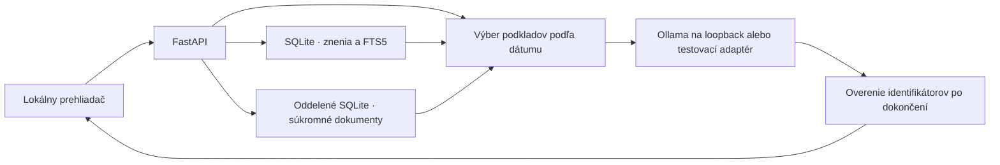

# Architektúra

React a TypeScript poskytujú jedno lokálne rozhranie. V zostavenej aplikácii ho servíruje FastAPI z rovnakého pôvodu ako API. Vite pri vývoji posiela `/api` na loopback adresu backendu.

`Store` inicializuje schému a transakčne zapisuje znenie, úseky a index. Opakovaný import rovnakého znenia je bez zmeny. Ak to isté ID príde s novým obsahom, import zlyhá pred zmenou dát. Súkromný dokument sa nepridáva do právneho indexu. Vybrané úryvky vstupujú do otázky iba pri explicitnom pripojení dokumentu.

`rag.answer` pripravuje rozpočtovaný kontext, komunikuje cez protokol `ModelRuntime` a dokončenú odpoveď kontroluje. Chat posiela NDJSON udalosti `start`, `delta` a `done`; pri chybe odošle `error`. Priebežný text je označený ako neoverený. Karty zdrojov vzniknú iba z identifikátorov nájdených medzi vstupnými úsekmi. Text citácie mimo podporovaného formátu môže model stále vymyslieť.

Kontext používa odhad podľa počtu znakov. Nie je to počítanie tokenov pre konkrétny model. Výber úryvkov je lexikálny a každá otázka sa vyhodnotí samostatne. Pre llama.cpp možno doplniť implementáciu rovnakého protokolu cez lokálne rozhranie a konvertovať jeho stream na `Chunk`. Táto integrácia zatiaľ chýba.
